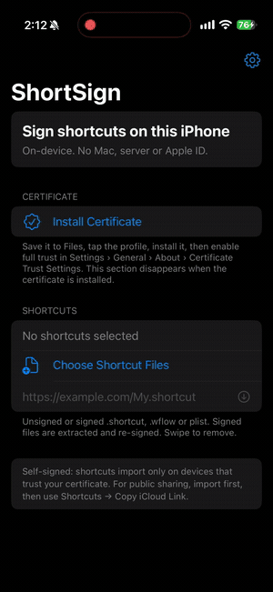

# ShortSign

Sign Apple Shortcuts on a stock iPhone. No Mac, server, or Apple ID.

[Download the latest unsigned IPA](https://github.com/dan1165/shortsign/releases/latest)

*Install certificate → pick a shortcut → sign → share.*

## Use

1. Install the IPA with your sideloader.
2. If the **Certificate** section appears, tap **Install Certificate**, install
   the profile, then enable full trust in Settings › General › About ›
   Certificate Trust Settings. The section hides automatically once installed.
3. Pick one or more unsigned or signed shortcuts, paste an https URL, or open a
   file from Files. Signed shortcuts are extracted and re-signed.
4. Tap **Sign Shortcut** (or **Sign N Shortcuts**). The share sheet opens; choose
   Shortcuts. If you cancel, tap **Share Again**.

The gear shows certificate status and fingerprint, lets you reinstall the
certificate, and shows the app version.

## Public links

After importing, open the shortcut in Shortcuts and use **Share → Copy iCloud
Link**. Recipients do not need the ShortSign certificate — Shortcuts uploads its
own Apple-signed copy.

## Limits

- Direct file sharing is self-signed and per-device.
- The bundled signing key is public; only trust the certificate on devices you
  control.
- iOS 17+.

## Build

GitHub Actions (`macos-26-intel`, xtool, Xcode 26) builds an unsigned IPA on
every push to `main` and publishes a release. Local Linux builds need an Xcode
SDK; use `./tools/local-build.sh` to build with the latest release version.

## Credits

libshortcutsign and libNeoAppleArchive by 0xilis (MIT), lzfse (BSD-3, Apple),
libzbitmap (MIT, Corellium), OpenSSL (Apache-2.0). Licenses are in `Licenses/`.
